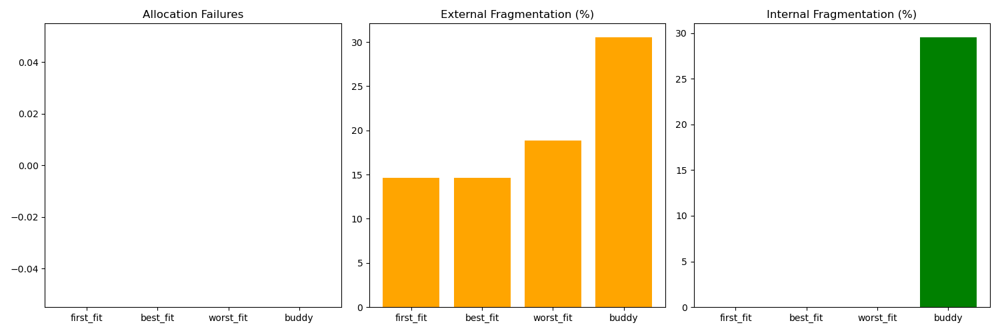

# Task 09 — Variant B

## Description

In this task, I created a memory allocation simulator using Python. The program compares First Fit, Best Fit, Worst Fit and the Buddy System.

## Allocation Strategies

- First Fit selects the first suitable free block.
- Best Fit selects the smallest suitable free block.
- Worst Fit selects the largest suitable free block.
- Buddy System divides memory into blocks with sizes that are powers of two.

## Coalescing

Coalescing combines neighbouring free memory blocks into one larger block. This reduces external fragmentation and helps prevent allocation failures.

## Testing

I created a custom operation sequence called `ops2` with 128 units of memory.

The program measures:

- Number of allocation failures.
- Average external fragmentation.
- Average internal fragmentation.

## Results

First Fit without coalescing had one allocation failure and 36.27% average external fragmentation.

Best Fit produced 14.66% average external fragmentation.

The Buddy System produced 29.56% average internal fragmentation because memory requests are rounded up to powers of two.

## Buddy System Disadvantage

The Buddy System reduces external fragmentation by merging matching free blocks. However, it does not completely remove external fragmentation.

Its main disadvantage is wasted space inside allocated blocks. For example, a request for 20 units receives 32 units, leaving 12 units unused.

## Running the Program

```bash
python3 memory_manager.py
python3 graph.py
```

## Files

- `memory_manager.py` — memory allocation simulator.
- `graph.py` — creates the comparison graph.
- `results.txt` — experimental results.
- `comparison.csv` — comparison table.
- `comparison.png` — comparison graph.

## Comparison Graph



## Conclusion

This task helped me understand different memory allocation strategies, memory fragmentation and the importance of merging free memory blocks.
