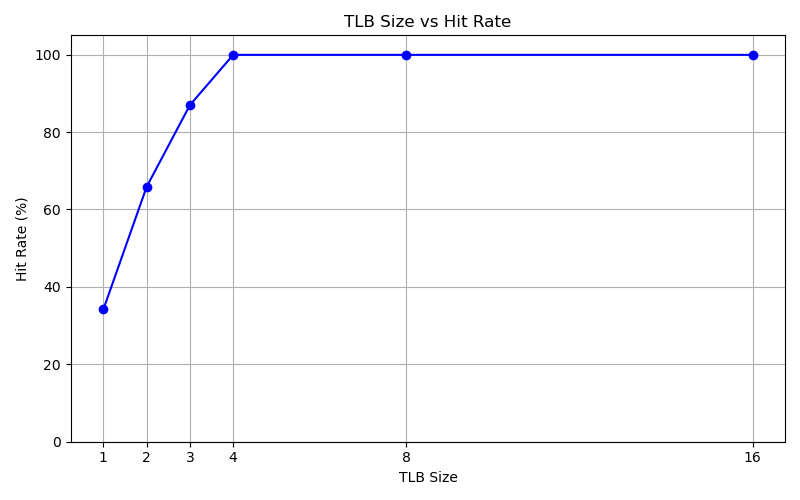

# Task 10 — Variant B

## Description

In this task, I created a Python simulation of the Translation Lookaside Buffer (TLB) using the LRU replacement algorithm.

## TLB

The TLB stores recently used page translations.

A TLB hit happens when the required page translation is already stored.

A TLB miss happens when the translation is not stored and the page table must be checked.

## LRU

LRU means Least Recently Used.

When the TLB is full, the least recently accessed entry is removed to make space for a new entry.

## Effective Access Time

Memory access time is 100 ns.

TLB access time is 10 ns.

A TLB hit requires 110 ns.

A TLB miss with a single-level page table requires 210 ns, assuming the page is present.

| Hit Rate | Effective Access Time |
|---|---|
| 0% | 210 ns |
| 25% | 185 ns |
| 50% | 160 ns |
| 75% | 135 ns |
| 90% | 120 ns |
| 100% | 110 ns |

## Testing

The program uses refs.txt to record TLB hits and misses.

It also generates 10,000 addresses with locality to compare different TLB sizes.

Because the simulation has four mapped pages, increasing the TLB size beyond four entries does not improve the hit rate.

## Two-Level Page Table

A two-level page table requires two memory accesses to find the physical frame.

A third memory access is required to access the actual data.

Without a TLB, the total access time is 300 ns.

## Running

```bash
python3 tlb.py
python3 graph.py
```

## Results

The experimental results are stored in results.txt and comparison.csv.

## Comparison Graph



## Conclusion

This task helped me understand how the TLB improves memory access performance, how LRU works and how multi-level page tables translate addresses.
