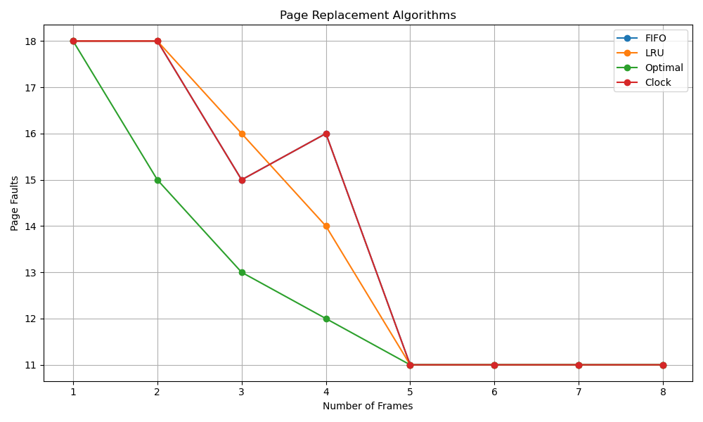

# Task 11 — Variant B

## Description

In this task, I compared four page replacement algorithms: FIFO, LRU, Optimal and Clock.

## Clock Algorithm

Clock uses a reference bit for each page.

When a page is accessed, its reference bit becomes 1.

When a page needs to be replaced, Clock checks the reference bit. If the bit is 1, the page receives a second chance and its bit becomes 0. If the bit is 0, the page can be replaced.

## Clock vs LRU

LRU tracks the order in which pages are accessed.

Clock uses reference bits instead of maintaining the exact order of access.

Clock is an approximation of LRU and can be simpler to implement in an operating system. The execution times of the Python simulations are recorded in results.txt.

## Belady's Anomaly

Belady's anomaly happens when increasing the number of memory frames causes more page faults.

FIFO produced 9 page faults with 3 frames and 10 page faults with 4 frames.

LRU and Optimal do not have this anomaly because they have the stack property.

## Locality

The program compares two reference strings:

- A string with locality, where the same group of pages is accessed repeatedly.
- A random string, where pages are selected randomly.

Locality usually reduces page faults because recently used pages are more likely to be needed again.

## Testing

The program compares all four algorithms using memory frames from 1 to 8.

It measures the number of page faults and compares the execution times of LRU and Clock.

## Running

```bash
python3 simulation.py
python3 graph.py
```

## Files

- replace.py — FIFO, LRU and Optimal algorithms.
- simulation.py — Clock algorithm and experiments.
- graph.py — creates the comparison graph.
- comparison.csv — comparison table.
- comparison.png — comparison graph.
- results.txt — experimental results.

## Comparison Graph



## Conclusion

This task helped me understand different page replacement algorithms, Belady's anomaly and how locality affects page faults.
